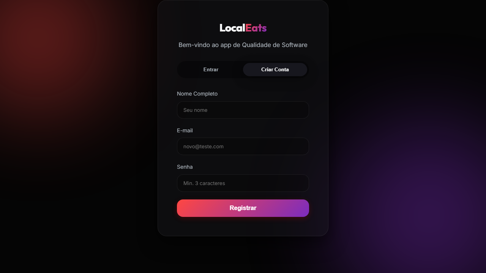

# Atividade 4: Testes Automatizados do LocalEats

## 1. Identificação

- **Unidade Curricular:** Qualidade de Software.
- **Turma:** ads-2026-noite.
- **Modalidade:** individual.
- **Integrante:** Leonardo Souza Bezerra (@Leonardo-S-b).
- **Repositório:** <https://github.com/Leonardo-S-b/trabalho_qualidade>.
- **Diretório da atividade:** <https://github.com/Leonardo-S-b/trabalho_qualidade/tree/main/atividades/atividade-04>.
- **Data da última execução:** 10/11/2026.
- **Sistema:** <https://local-eats-unisenac.vercel.app/>.

## 2. Integrantes e responsabilidades

| ID | Integrante responsável | Tipo | Comportamento verificado | Arquivo e função de teste |
|---|---|---|---|---|
| TU01 | Leonardo Souza Bezerra | Unitário | Aceitar quantidade 3 | `tests/test_regras_localeats.py::test_quantidade_dentro_da_faixa_e_valida` |
| TU02 | Leonardo Souza Bezerra | Unitário | Rejeitar quantidade zero | `tests/test_regras_localeats.py::test_quantidade_zero_e_invalida` |
| TU03 | Leonardo Souza Bezerra | Unitário parametrizado | Aceitar os limites 1 e 10 | `tests/test_regras_localeats.py::test_limites_da_faixa_sao_validos` |
| TU04 | Leonardo Souza Bezerra | Unitário | Rejeitar quantidade 11 | `tests/test_regras_localeats.py::test_quantidade_acima_do_maximo_e_invalida` |
| TU05 | Leonardo Souza Bezerra | Unitário | Gerar ValueError para -1 | `tests/test_regras_localeats.py::test_quantidade_negativa_gera_erro` |
| TF01 | Leonardo Souza Bezerra | Funcional | Exibir cadastro e ocultar login ao clicar em Criar Conta | `tests/test_localeats.py::test_criar_conta_exibe_formulario_de_cadastro` |

São cinco funções de teste unitário e uma funcional. TU03 produz duas execuções, identificadas como `minimo-1` e `maximo-10`; o total coletado pelo pytest é sete. A parametrização acrescenta cobertura dos limites e não é utilizada para substituir os dois comportamentos mínimos exigidos: TU01 e TU02.

## 3. Testes unitários

### Regra de Leonardo Souza Bezerra

- **Regra escolhida:** regra 3, validar quantidade de itens.
- **Função implementada:** `quantidade_itens_valida(quantidade)`.
- **Implementação:** [src/regras_localeats.py](src/regras_localeats.py).
- **Testes:** [tests/test_regras_localeats.py](tests/test_regras_localeats.py).

A função retorna `True` de 1 a 10, inclusive; retorna `False` para zero e valores acima de 10; gera `ValueError` para valores negativos. Os dados do exercício são quantidades inteiras. Os testes cobrem valor comum, zero, ambas as fronteiras, o primeiro inteiro acima do máximo e a exceção.

Esta é uma implementação Python da regra solicitada na atividade. Ela não integra o código do site e seus testes não demonstram que o LocalEats aplica o limite de dez itens na API. Na Atividade 3, esse limite superior não era conhecido; aqui ele é explicitamente fornecido pelo enunciado da Atividade 4.

## 4. Aplicação do TDD

### TDD de Leonardo Souza Bezerra

- **Regra escolhida:** quantidade de itens.
- **Primeiro teste escrito:** `test_quantidade_dentro_da_faixa_e_valida`, com entrada 3 e retorno esperado `True`.
- **Por que o teste falhou inicialmente:** o módulo `src.regras_localeats` ainda não existia. A execução terminou com erro de coleta `ModuleNotFoundError`.
- **Implementação mínima realizada:** criação da função retornando apenas `True`. A nova execução aprovou o primeiro teste.
- **Segundo teste escrito:** `test_quantidade_zero_e_invalida`, com entrada 0 e retorno esperado `False`. A execução teve um aprovado e um reprovado, pois a implementação aceitava qualquer entrada.
- **Ajuste realizado:** substituição do retorno constante pela comparação `1 <= quantidade <= 10`. Os dois testes passaram.
- **Ampliação da cobertura:** inclusão dos testes para 1, 10, 11 e -1. Cinco execuções passaram e a de -1 falhou com `DID NOT RAISE ValueError`.
- **Melhoria realizada:** inclusão da verificação de negativo antes da comparação e de uma docstring que explica o contrato. Os limites foram agrupados em um teste parametrizado, sem duplicar a lógica. Não foi necessária uma refatoração estrutural adicional.

Esses resultados correspondem às execuções intermediárias realizadas durante a preparação. O relatório entregue contém a execução final completa, após a implementação e a inclusão do teste funcional.

## 5. Testes funcionais com Playwright

### Teste funcional de Leonardo Souza Bezerra

- **ID:** TF01.
- **Fluxo automatizado:** alternar da tela de login para o formulário de cadastro.
- **Exploração:** a entrada do site apresentou os botões `Entrar` e `Criar Conta`. Após clicar em `Criar Conta`, apareceram `Nome Completo`, os campos de cadastro e o botão `Registrar`.
- **Pré-condição verificada:** o campo de login com placeholder `teste@teste.com` está visível.
- **Interação realizada:** clique no botão `Criar Conta`, localizado por papel e nome exato.
- **Primeira assertion após a interação:** o campo `Seu nome` deve estar visível.
- **Segunda assertion após a interação:** o campo `novo@teste.com` deve estar visível.
- **Verificações adicionais:** o campo `Min. 3 caracteres` e o botão `Registrar` devem estar visíveis; os campos `teste@teste.com` e `Sua senha secreta` devem estar ocultos.
- **Arquivo e função:** [tests/test_localeats.py](tests/test_localeats.py), `test_criar_conta_exibe_formulario_de_cadastro`.
- **Resultado final:** aprovado em Chromium.

Os locators foram definidos a partir dos elementos encontrados no site. As verificações usam `expect`, que aguarda automaticamente o estado esperado, sem `time.sleep`. A fixture `page` fornece um contexto de navegador isolado. O teste não depende de conta cadastrada ou de execuções anteriores.

O escopo é a troca de formulários; não verifica a criação de uma conta, a autenticação ou o fluxo de pedidos planejado na Atividade 3. Essa escolha cobre um comportamento estável permitido pelo enunciado, sem exigir credenciais.

**Evidência da execução:**



A captura é produzida pelo próprio teste depois das assertions. As animações são desativadas somente na captura, para evitar registrar uma transição visual incompleta.

## 6. Resultado da execução

- **Quantidade total de execuções:** 7, sendo 6 unitárias e 1 funcional.
- **Aprovadas:** 7.
- **Reprovadas:** 0.
- **Ignoradas:** 0.
- **Relatório:** [relatorio-pytest.txt](relatorio-pytest.txt).
- **Ambiente:** Windows, Python 3.14.0, pytest 9.2.0, pytest-playwright 0.10.0, Playwright 1.65.0 e Chromium.
- **Observações:** todos os testes foram aprovados. Foi emitido um aviso `PytestRemovedIn10Warning` referente à fixture `base_url` de dependência do plugin. O aviso está preservado no relatório e não representa falha dos testes.

### Como reproduzir no PowerShell

Partindo da raiz do repositório:

```powershell
python -m venv .venv
.\.venv\Scripts\python.exe -m pip install -r atividades/atividade-04/requirements.txt
.\.venv\Scripts\python.exe -m playwright install chromium
cd atividades/atividade-04
..\..\.venv\Scripts\python.exe -X utf8 -m pytest -v | Tee-Object -FilePath relatorio-pytest.txt
```

O executável explícito do ambiente virtual evita depender da política de execução de scripts de ativação. Com esse ambiente ativado, o comando do enunciado é equivalente:

```powershell
python -m pytest -v | Tee-Object -FilePath relatorio-pytest.txt
```

O teste funcional necessita de internet e do site disponível. Alterações nos placeholders ou botões podem exigir atualização dos locators. Depois de qualquer alteração no código, o relatório deve ser gerado novamente. Para exibir o relatório corretamente no GitHub, salve-o em UTF-8 se sua versão do PowerShell usar UTF-16 no `Tee-Object`.

## 7. Explicações individuais

### Explicação do teste de Leonardo Souza Bezerra

- **Teste escolhido:** `test_quantidade_negativa_gera_erro` (TU05).
- **Comportamento verificado:** uma quantidade negativa deve causar uma exceção, em vez de ser aceita ou retornar simplesmente `False`.
- **Dados ou estado inicial:** entrada -1; a função não depende de banco de dados, navegador ou estado compartilhado.
- **Resultado esperado:** `ValueError` com uma mensagem contendo `negativa`.
- **Como funciona:** `pytest.raises` acompanha a chamada dentro do bloco `with`. O teste passa quando a exceção esperada é lançada e sua mensagem corresponde ao trecho indicado por `match`.
- **O que faria o teste falhar:** retornar `False`, retornar `True`, não lançar exceção, lançar outro tipo ou remover o trecho esperado da mensagem. Durante o TDD, ele falhou porque a comparação de faixa retornava `False` para -1, sem lançar `ValueError`.

## 8. Uso de inteligência artificial

- **Ferramenta utilizada:** Codex (OpenAI).
- **Como foi utilizada:** apoio à leitura dos requisitos e das atividades anteriores, preparação dos testes, execução dos ciclos de TDD, exploração da interface com Playwright e redação deste documento.
- **Uma sugestão que precisou ser alterada:** a comparação de faixa sozinha foi insuficiente para implementar a regra completa.
- **Motivo da alteração:** o teste de negativo demonstrou que retornar `False` não atende ao requisito de gerar `ValueError`. Foi acrescentada a verificação de negativo antes do retorno.
- **Como o código foi verificado:** execução real dos testes com pytest, inspeção dos elementos reais da interface, conferência da captura e comparação dos nomes da tabela com os testes coletados no relatório. As execuções e a preparação foram realizadas com assistência da ferramenta; não constituem uma declaração de revisão pessoal já concluída pelo estudante.

## 9. Diferenciais opcionais

- [x] Casos de borda: [TU02, TU03 e TU04](tests/test_regras_localeats.py).
- [x] `pytest.raises`: [TU05](tests/test_regras_localeats.py).
- [x] Parametrização: [TU03](tests/test_regras_localeats.py), com entradas 1 e 10.
- [x] Screenshot real: [captura do TF01](evidencias/TF01-formulario-cadastro.png).
- [x] Registro de falha encontrada e corrigida durante o TDD: seção 4, tratamento de negativos. Trata-se de falha da implementação local, não de um defeito comprovado no site.

## 10. Revisão e entrega

A implementação, a explicação e os resultados estão disponíveis para revisão do estudante. Antes de enviar, Leonardo deve executar os comandos, compreender os testes e revisar a explicação individual. Este documento não atesta que essa etapa pessoal já aconteceu.

Após publicar estes arquivos na branch `main`, o link de entrega no Blackboard será:

<https://github.com/Leonardo-S-b/trabalho_qualidade/blob/main/atividades/atividade-04/atividade-04-testes-automatizados.md>
